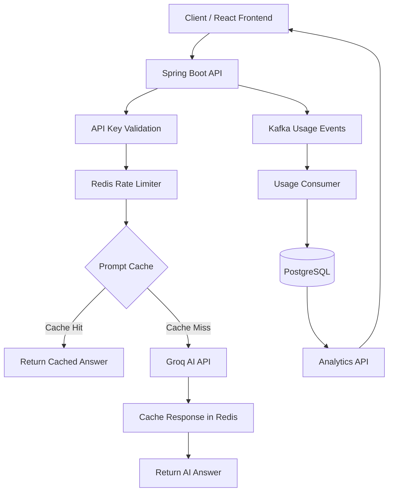

# LLM Gateway — AI Request Management & Cost Control

A full-stack LLM gateway built with Java 21, Spring Boot, React, and TypeScript. It provides a centralized API layer for AI requests, with API-key authentication, rate limiting, prompt caching, and usage analytics.

**Live Demo:** https://llm-gateway-xi.vercel.app  
**Backend:** https://llm-gateway-pbls.onrender.com  
**Repository:** https://github.com/Ankit-code02/llm-gateway

## Overview

Applications that integrate large language models need a way to manage access, control request volume, reuse repeated responses, and monitor usage.

LLM Gateway provides a central layer between client applications and an AI provider. Instead of connecting clients directly to the provider, applications send requests through the gateway.

## Features

- **AI request handling:** Submit prompts through a REST API and receive AI-generated responses.
- **API-key authentication:** Authenticate requests using an `X-API-Key` header.
- **Rate limiting:** Limit requests per API key using Redis.
- **Prompt caching:** Cache repeated prompts in Redis to reduce unnecessary provider calls.
- **Usage tracking:** Publish usage events through Kafka and store usage records in PostgreSQL.
- **Analytics API:** Retrieve request totals and cache hit/miss statistics.
- **Provider configuration:** Configure the AI provider and model using environment variables.
- **Web interface:** React and TypeScript frontend for interacting with the gateway.

## Technology Stack

| Layer | Technologies |
|---|---|
| Backend | Java 21, Spring Boot 3, Spring Security |
| Frontend | React, TypeScript, Vite |
| Database | PostgreSQL |
| Cache and rate limiting | Redis |
| Messaging | Apache Kafka |
| AI provider | Groq API |
| Containerization | Docker, Docker Compose |
| Frontend deployment | Vercel |
| Backend deployment | Render |

## Architecture



## API Reference

### 1. Generate an AI response

`POST /v1/chat`

Headers:

```http
Content-Type: application/json
X-API-Key: YOUR_API_KEY
```

Request body:

```json
{
  "prompt": "Explain dependency injection in Spring Boot."
}
```

Example response:

```json
{
  "answer": "Dependency injection is a technique..."
}
```

### 2. Retrieve analytics

`GET /internal/analytics/summary`

Header:

```http
X-Admin-Token: YOUR_ADMIN_TOKEN
```

The response includes request totals, cache hits, cache misses, and cache hit rate.

### 3. Create an API key

`POST /internal/api-keys`

Request body:

```json
{
  "teamName": "demo-team",
  "keyName": "development-key"
}
```

This endpoint requires the setup feature to be temporarily enabled. Disable setup access again after creating the required key. Never expose the admin token or API keys in frontend code or public documentation.

## Local Development

### Prerequisites

- Java 21
- Node.js and npm
- Docker Desktop with Docker Compose
- Git
- A Groq API key for AI requests

### 1. Clone the repository

```bash
git clone https://github.com/Ankit-code02/llm-gateway.git
cd llm-gateway
```

### 2. Start the supporting services

From the repository root:

```bash
docker compose up -d
```

The local configuration uses PostgreSQL on port `5433`, Redis on port `6379`, and Kafka on port `9092`.

### 3. Configure the backend

Set the required environment variables in your terminal or IDE run configuration:

- `AI_PROVIDER=groq`
- `GROQ_API_KEY` — your Groq API key
- `GROQ_MODEL=openai/gpt-oss-20b`
- `LLM_GATEWAY_ADMIN_TOKEN` — a strong private admin token
- `GATEWAY_SETUP_ENABLED=false` for normal operation

Configure the PostgreSQL, Redis, and Kafka connection variables if your local service settings differ from the defaults.

### 4. Run the backend

From the `backend` directory:

```bash
mvn spring-boot:run
```

If Maven is not installed, use the Maven Wrapper if it is available in the project.

The backend defaults to port `8080`.

### 5. Run the frontend

Open a separate terminal:

```bash
cd frontend
npm install
npm run dev
```

For local development, the Vite configuration proxies API requests to the backend on port `8080`.

### 6. Build and test

Backend:

```bash
mvn test
mvn -DskipTests package
```

Frontend:

```bash
npm run lint
npm run build
```

Run these commands from the relevant `backend` or `frontend` directory.

## Environment Variables

Never commit real credentials. Use environment variables for local development and configure secrets in your hosting provider.

| Variable | Purpose |
|---|---|
| `PORT` | Backend server port |
| `AI_PROVIDER` | Selects the AI provider |
| `GROQ_API_KEY` | Groq authentication credential |
| `GROQ_MODEL` | Configured Groq model |
| `SPRING_DATASOURCE_URL` | PostgreSQL JDBC URL |
| `SPRING_DATASOURCE_USERNAME` | Database username |
| `SPRING_DATASOURCE_PASSWORD` | Database password |
| `SPRING_DATA_REDIS_HOST` | Redis hostname |
| `SPRING_DATA_REDIS_PORT` | Redis port |
| `SPRING_DATA_REDIS_PASSWORD` | Redis credential |
| `SPRING_DATA_REDIS_SSL_ENABLED` | Enables Redis TLS when required |
| `SPRING_KAFKA_BOOTSTRAP_SERVERS` | Kafka broker address |
| `KAFKA_SECURITY_PROTOCOL` | Kafka security protocol |
| `KAFKA_SASL_MECHANISM` | Kafka SASL mechanism |
| `KAFKA_SASL_JAAS_CONFIG` | Kafka authentication configuration |
| `LLM_GATEWAY_ADMIN_TOKEN` | Private admin API token |
| `GATEWAY_SETUP_ENABLED` | Controls temporary API-key setup access |
| `CORS_ALLOWED_ORIGIN` | Allowed frontend origin |
| `VITE_API_BASE_URL` | Backend base URL used by the frontend |

## Deployment

- **Frontend:** Deployed on Vercel.
- **Backend:** Deployed on Render using Docker.
- **Database:** PostgreSQL hosted on Aiven.
- **Cache:** Redis hosted on Upstash.
- **Messaging:** Kafka hosted on Aiven.
- **AI provider:** Groq.

The production frontend and backend communicate using `VITE_API_BASE_URL`. The backend's CORS configuration must allow the deployed frontend origin.

## Testing and Performance

Backend unit tests and frontend lint/build checks have passed during development.

Production integration checks and performance measurements should be recorded after running repeatable tests against the deployed system.

| Measurement | Result |
|---|---|
| Cache hit rate | Not measured yet |
| Cached request latency | Not measured yet |
| Uncached request latency | Not measured yet |
| Estimated provider cost savings | Not measured yet |

Do not interpret the deployment health check as proof that every external integration has been tested.

## Security Considerations

- Keep API keys, provider credentials, database passwords, and admin tokens private.
- Do not enable API-key setup access permanently.
- Use HTTPS for production API communication.
- Keep production CORS origins restricted to trusted frontend domains.
- Avoid logging sensitive prompts, credentials, or personal information.
- Validate authentication, rate limiting, and authorization behavior before production use.

## Future Improvements

Potential next steps include:

- Integration testing with Testcontainers
- Automated CI checks with GitHub Actions
- Retry and timeout policies for AI provider failures
- Expanded analytics for latency, cost, and usage by team
- Performance benchmarking and documented results
- Kubernetes deployment manifests

## License

Add a license file if you intend to distribute this project under an open-source license.
